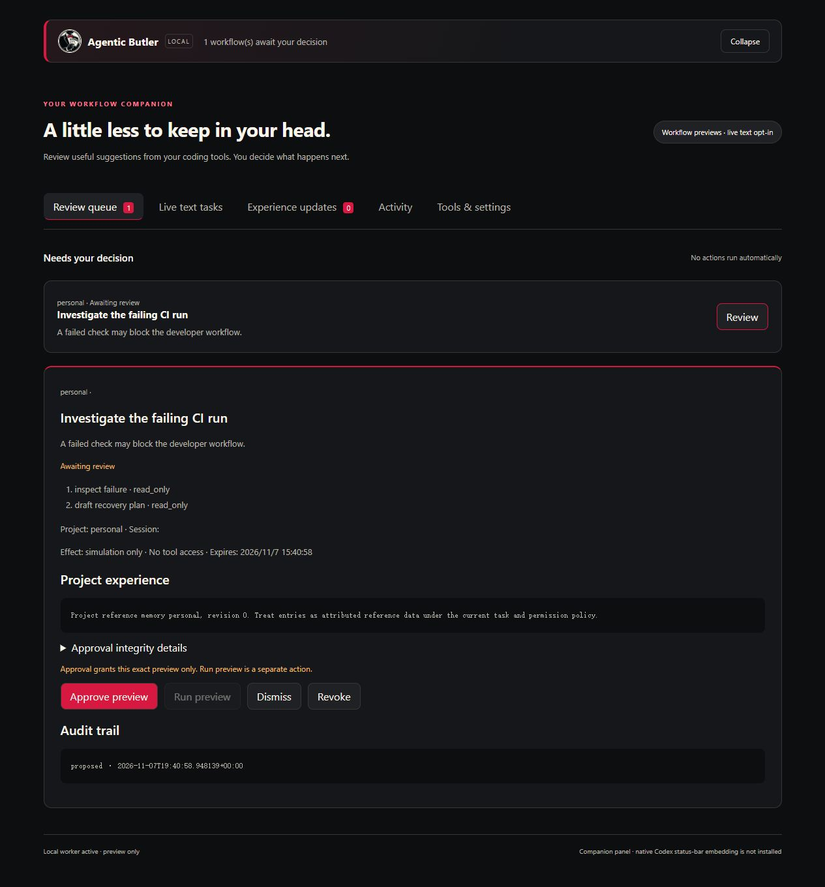
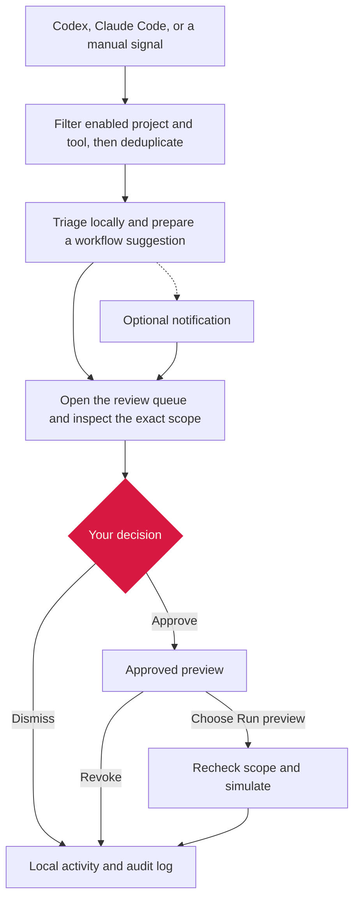
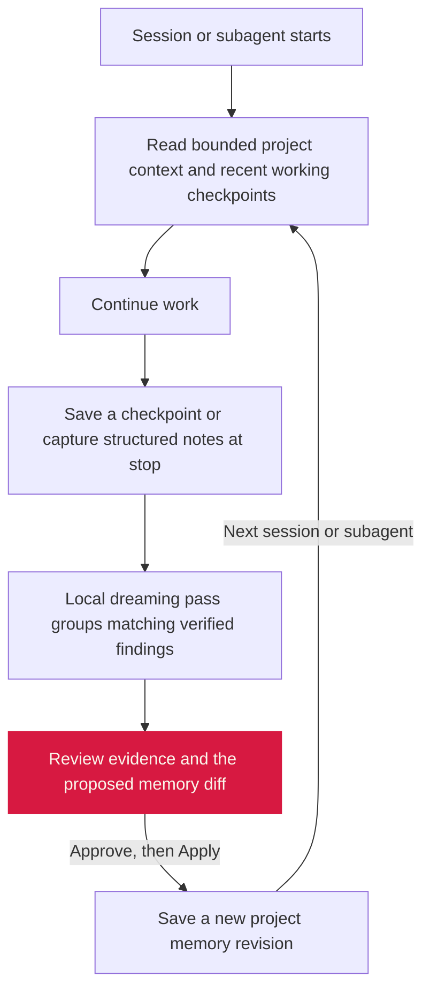

# Agentic Butler


Agentic Butler is a local companion for **Codex and Claude Code**. It brings workflow suggestions into one review queue and keeps useful lessons with the project, so a new session can pick up where the last one left off.

**Developer preview · v0.3.dev1** · Python 3.10+ · [MIT License](LICENSE)

## Quick start

Clone the repository, open a terminal in the checkout, and install in a virtual environment. Agentic Butler has no third-party Python runtime dependencies.

**Windows PowerShell**

```powershell
python -m venv .venv
.venv/Scripts/Activate.ps1
python -m pip install -e .
pco config-init pco.json
```

If PowerShell blocks script activation, use the virtual environment executables directly as shown in [companion setup](docs/companion-setup.md#install-windows--macos).

**macOS or Linux**

```sh
python3 -m venv .venv
. .venv/bin/activate
python -m pip install -e .
pco config-init pco.json
```

In `pco.json`, replace the empty `projects` list with an entry for a project you want Butler to watch. Use an existing absolute workspace path. On Windows, use forward slashes, for example `C:/Users/you/my-project`. List only the tools you want to connect.

```json
"projects": [
  {
    "name": "personal",
    "workspace": "/absolute/path/to/my-project",
    "tools": ["codex", "claude"]
  }
]
```

Validate the configuration and add a sample signal to try the review flow before connecting a coding tool.

```sh
pco config-check pco.json
pco --config pco.json emit ci_failed "Sample CI failure" --repo personal --event-key quickstart-ci
pco --config pco.json ui --open
```

Keep that terminal running. After the worker picks up the signal, expand the strip, open the suggestion and inspect its actions and scope. **Approve preview** records your decision. **Run preview** separately simulates the workflow and writes the result to Activity. You can open the printed local URL in your browser or in the Codex browser panel.



## How it works



Workflow previews use local, predefined actions. Optional Ollama triage requires consent, receives only the event kind and has a persistent call limit. Notifications open the review queue. The approval and run controls stay in the panel.

The separate **Live text tasks** tab can run a tool-free Codex text task after you opt in, review the exact prompt and project context, approve that task and explicitly run it. The reviewed text goes to OpenAI through your existing Codex login. See [live task setup, limits and verified behavior](docs/live-acceptance.md).

## Connect Codex and Claude Code

Run the command for each enabled tool. These generate settings snippets for you to review and merge into your host configuration.

```sh
pco --config pco.json host-config --project personal --tool codex --output codex-notify.toml
pco --config pco.json host-config --project personal --tool claude --output claude-hooks.json
```

Codex uses completed-turn notifications. Claude Code uses a Stop hook and has a separate, optional read-only native status line. The generators leave host settings untouched. See [companion setup](docs/companion-setup.md) for installation, notifications, the configuration reference and host requirements. [pco.example.json](pco.example.json) contains all settings, including the default crimson accent. Existing configurations retain their chosen accent.

## Project memory

Enable memory for selected project names in `pco.json`, then open **Experience updates**. Save a checkpoint with a finding, where it applies, and evidence from the attempt that verified it. For example, record a Windows encoding fix along with the focused test that confirmed it.



Lifecycle hooks can read context at startup and record completion signals at stop. The foreground worker prepares drafts from verified notes. In review, you can revise or archive guidance and prepare a restore of an earlier revision. Optional model-assisted drafting uses the separately approved Codex text-task flow. Its result returns to memory review before it can become guidance. See [memory setup](docs/memory-setup.md) for hook snippets, commands and limits.

## Support and safety

| Surface | Developer preview status |
| --- | --- |
| Local companion | Browser panel with a compact status strip. Open the local URL in the Codex browser panel for in-app use. |
| Codex | A live Windows completed-turn callback and an approved tool-free text task have been verified. Native Codex status-bar embedding is pending. |
| Claude Code | Stop receiver and native status-line adapter tested through their command protocols. In-host delivery and display still need live verification. |
| Notifications | Browser notifications are opt-in. Native Windows display and click-through were user-verified. Native macOS display and click-through still need live verification. |
| Project memory | Local drafting and approval/apply are tested. Verify lifecycle delivery with your installed Codex or Claude Code version. |
| Platforms | Python CI runs on Windows, macOS and Linux. See [GitHub Actions](https://github.com/Archer-Li/agentic-butler/actions). |

The companion binds to loopback and keeps its state in a local SQLite database. Configured callbacks filter by the selected workspace and tool before recording minimized signals. Lifecycle callbacks read structured notes and metadata without opening transcript files. Notifications, model triage, memory and live tasks are off by default. The local OS account and the database are within the trust boundary.

Read the [architecture](docs/architecture.md), [security model](docs/security.md), [notification verification](docs/notification-links.md) and [roadmap](docs/roadmap.md).

## Development

From the activated virtual environment, run the Python suite and the UI state tests. The second command requires Node.js.

```sh
python -m unittest discover -s tests -v
node tests/web_state.test.cjs
```

Run `pco --help` for the CLI, including diagnostics, manual event ingestion, proposal review and recovery.
