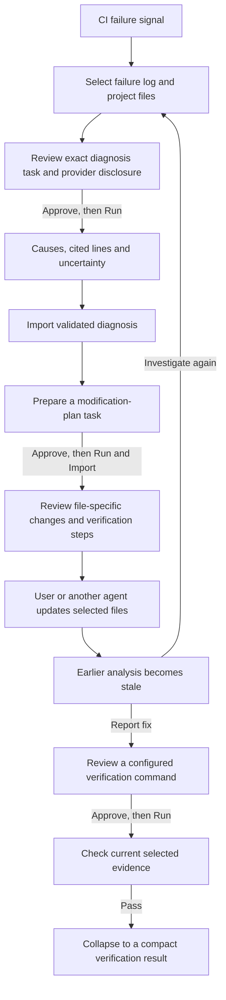

# CI investigations

The first P0 workflow imports selected failure evidence, prepares a separately approved diagnosis, then prepares a separately approved modification plan. It observes the selected files so recommendations can adapt to changes made by you or another agent.

## Enable and import

Set `ci.enabled` to true in the application JSON. Keep the existing personal project/tool allowlist. Model analysis additionally requires `agent.enabled`; verification requires a configured local command. Existing configurations migrate with CI investigations disabled.

In **CI investigations**, choose a CI failure proposal, paste a failure log and specify 1–4 project-relative file paths. Alternatively, enter a failed local command task ID to use its captured output. Imported logs must fit 4000 UTF-8 bytes, each selected file must fit 4000 bytes, and the combined evidence snapshot must fit 6000 serialized bytes. Import and observation are local.

This version accepts exported CI logs and failed local command output. The original signal identifies the investigation. Remote GitHub run/job log download and authentication are follow-up work. A pasted log is user-supplied evidence, not authenticated remote CI status.



## Diagnose and plan

Choose **Prepare diagnosis for review**, then inspect the task in **Live text tasks**. The prompt contains the exact selected failure log and file snapshots. The approval disclosure identifies OpenAI as the recipient through the existing Codex login. Approve and run are separate actions. No tools are granted to the model.

Return to **CI investigations** and choose **Import completed diagnosis**. The importer requires the completed task to belong to this case, validates its JSON fields and requires cited sources and line numbers to exist in the supplied evidence. Citation validation checks references, not the truth of a model's interpretation. Findings explicitly distinguish supported observations from hypotheses.

**Prepare modification plan for review** creates a new task with the current evidence and imported diagnosis. It requires its own approval and run. Import yields file-specific proposed edits, cited evidence and validation steps. The model can propose changes only to selected paths. The plan is displayed locally for review and does not apply files. The existing 8000-byte text-task input limit also covers the plan prompt. Shorten the evidence or diagnosis if necessary.

## Cooperate with ongoing work

The companion rechecks selected file contents on state refresh. Approve, run and import also check their evidence fingerprints. Changing a selected file makes earlier model tasks stale and blocks their approval/run/import. A running task polls the same check and requests cancellation when its evidence changes. No model call is dispatched by observing a change.

Changed files are evidence of activity, not proof that a problem is fixed. A newly prepared task uses their current contents. Old diagnoses and plans remain visible with a stale warning.

**I have made the fix** records an explicit user report, retires the original repair reminder from the active preview queue and reduces the investigation to verification. It invalidates old analysis approvals. **Investigate again** begins a new review generation and keeps the earlier approvals invalid.

Select **Review verification** for a configured command in the same project. It creates an independent pending command bound to the current selected evidence. Approve and run it in **Local commands**. A zero exit code for that snapshot collapses the investigation to a compact result. Changing a selected file again removes the verified state. A passing local command proves that selected check passed, and does not establish that full remote CI passed.

The observation boundary is the selected files. Unselected code, dependencies, configuration outside those files and external services can change without being detected. Whole-workspace revision binding, agent activity/ownership signals, remote CI verification, stronger process containment and crash reconciliation remain future work.

## CLI

Use UTF-8 stdin to provide a failure log for `ci-open`, or use `--command-id`.

```text
pco --config pco.json ci-open --proposal <proposal-id> --file calc.py --command-id <failed-command-id>
pco --config pco.json ci-list
pco --config pco.json ci-show <case-id>
pco --config pco.json ci-diagnose <case-id>
pco --config pco.json agent-show <diagnosis-task-id>
pco --config pco.json agent-approve <diagnosis-task-id> --expect-scope <reviewed-hash>
pco --config pco.json agent-run <diagnosis-task-id>
pco --config pco.json ci-import <case-id> --agent-id <diagnosis-task-id>
pco --config pco.json ci-plan <case-id>
```

Review, approve, run and import the plan task separately. After making a fix, use `ci-fixed <case-id>`, then `ci-verify <case-id> --name <configured-command>`. Complete its independent `command-approve` and `command-run` flow. `ci-resume <case-id>` returns to investigation.

## Verification scope

Regression tests exercise real local test processes, diagnosis/plan schemas, supplied-source citation boundaries, changed evidence, opt-out, cross-configuration isolation, fix reports, permanent invalidation across resume, and verification for the selected snapshot. Automated model fixtures test orchestration deterministically. Real provider acceptance is recorded separately from those fixtures.

Windows acceptance on 2026-11-16 used Codex CLI 0.169.0-alpha.11.1 with an independently authored addition function and failing unittest. Two real tool-free tasks produced a cited diagnosis and a separately approved file-specific plan. Browser interaction imported the plan, observed an interim edit as stale, reported the completed fix, approved and ran its verification, and displayed the compact successful result. This synthetic acceptance establishes integration behavior for one case. Diagnosis quality across real projects remains evaluation work.
