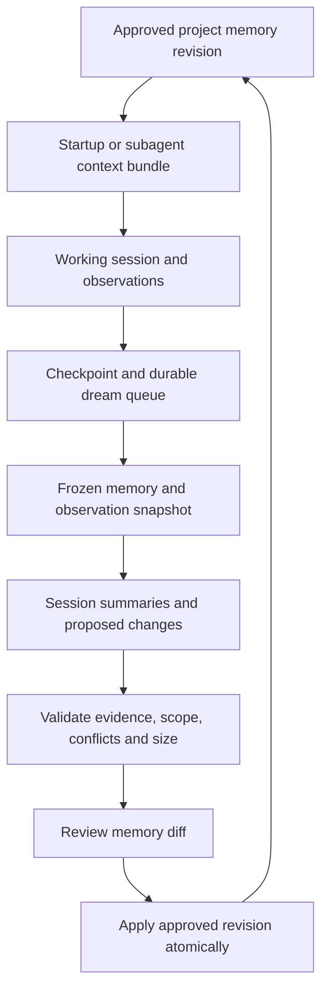

# Project memory and dreaming design

Design recorded 2026-11-06. The v0.3.dev1 implementation delivers local dreaming, scoped storage/review, lifecycle adapters and optional approved semantic tasks. See [implementation and setup](memory-setup.md) for shipped behavior and remaining work.

## Current code and intended outcome

The current application persists events, proposals, audit history and live text task results. `receivers.py` accepts Codex completed-turn notifications and Claude Stop callbacks. `core.py` contains a static `summarize_context` preview step. `live_agent.py` explicitly disables host memories and project instruction loading. Those were the gaps identified before the v0.3.dev1 implementation. The design below records the intended model.

The proposed outcome is a shared, versioned memory for each opted-in personal project, available across its sessions and supported coding tools. Agents contribute observations while working. Dreaming condenses those observations into reviewable changes. Approved revisions supply context for subsequent work.

## Memory layers

| Layer | Content | Update model |
| --- | --- | --- |
| Project memory | Validated project facts, decisions, conventions, reusable lessons and runbooks | Reviewed versioned changes |
| Working context | Session objectives, current progress, failed attempts, verified remedies and handoff notes | Bounded append-only observations after project opt-in |
| Dream candidate | Proposed additions, revisions, merges and retirements against a frozen memory revision | Generated draft, then validated and reviewed |

Give each project a stable `project_id`. Keep workspace and worktree membership explicitly configured against that ID. Session IDs, agent IDs and tool names identify contributors within the project. Local memory lives in namespaced SQLite tables. A rename preserves identity. Workspace remapping requires review of the project binding.

A record carries its ID, kind, text, applicability conditions, evidence IDs, verification state, creation/update times, revision, optional review date and superseded record IDs. User-pinned constraints remain a separately identified class. Observations carry the originating session/agent, delivery ID, outcome and bounded content. References establish provenance for every proposed lesson.

## Workflow

Reading and capture become automatic after explicit project memory opt-in. Long-term additions, revisions, merges and retirements require approval in the initial implementation. Model-backed drafting has its own consent, input disclosure and job budget. These defaults extend the existing approval-first policy to learned behavior.

During work, record structured observations at meaningful checkpoints. A host adapter may also save lifecycle metadata. The source of semantic learning is an explicit agent checkpoint or a user-reviewed summary. An exit signal alone establishes that a session ended. A durable fallback ingestion path supports tools with fewer hooks.

## Host lifecycle mapping

| Event | Proposed action |
| --- | --- |
| `SessionStart` | Read the approved bundle and recover unfinished bookkeeping |
| `SubagentStart` | Supply project memory and the parent task's bounded handoff |
| `SubagentStop` | Commit the agent checkpoint and enqueue eligible observations |
| `Stop` | Record a turn boundary and consume an explicit checkpoint |
| `PreCompact` | Persist working context needed for resumption |
| `SessionEnd` | Flush local metadata and durably enqueue dreaming |
| Orchestrator task completion | Finalize the checkpoint and request the same queue operation |

Both hosts currently document these lifecycle events. Codex also re-runs matching `SessionStart` handlers after root-session compaction. Its `PreCompact` plain stdout is ignored, while Claude's may influence the compaction summary. Adapters therefore need separate output serializers. Codex `SessionEnd` is main-thread-only and synchronous. Switching away does not immediately end it. Claude's end hook has a short default budget. These constraints favor quick local persistence and an independent worker. Sources checked 2026-11-06. [Codex hooks](https://learn.chatgpt.com/docs/hooks), [Claude hooks](https://code.claude.com/docs/en/hooks).

Emit bounded `additionalContext` only through the host's supported startup contract. Stop handlers use a successful advisory response. Their implementation must account for the host's output schema and `stop_hook_active`. Store diagnostic messages separately from hook stdout. Hook snippets remain generated artifacts that users merge into their chosen host settings.

Treat the hook list as documented capability. Acceptance still requires version checks, protocol fixtures and a real host session. The current repository receiver supports its existing completion inputs only.

## Context capture and retrieval

The first collection format is a small checkpoint containing the objective, useful discoveries, attempts, verification outcomes, decisions and unresolved next steps. The adapter validates project/workspace membership before recording content. Stable delivery IDs deduplicate retries. A provider with no delivery ID uses a documented fallback fingerprint with its coalescing limits exposed.

For orchestrator-owned text tasks, the reviewed prompt can request a structured checkpoint that the controller validates after completion. Host agents can submit checkpoints through an explicit adapter under project opt-in. A missing checkpoint creates an observable collection gap. Capture failures retain their own status so the next startup can expose unfinished handoffs.

Default collection accepts independently authored personal project notes. Transcript import requires a separate, reviewed source scope, byte limit and retention policy. Existing `transcript_path` fields remain untrusted input. Project bindings and approved input selection control what can enter a dream job.

Startup retrieval selects user-pinned constraints, applicable decisions, relevant verified lessons and a bounded current-session handoff. Scope filters apply before relevance ranking. A proposed initial context budget is 4 KiB, with reserved space for pinned constraints. An oversized pinned set produces a visible capacity issue for review. Every injected bundle includes its revision and record references, making the context supplied to a task reproducible.

A live task's approval envelope must include the exact memory bundle, revision and digest before approval. Its combined prompt must fit the executor's input cap. Running tasks retain their reviewed context until the next task boundary. Explicit record revocation invalidates affected pending tasks and requests a checkpoint/cancellation for affected active tasks. A normal newly approved memory revision becomes available to subsequent work.

Treat captured notes and model drafts as untrusted data. Serialize retrieved records with their attribution inside a fixed project-reference wrapper. Enforce execution permissions and input-source allowlists in code, and preserve the host's instruction priority. Review must expose embedded commands, requested permission changes and source conflicts before promotion.

## Dreaming pass

1. Claim one leased dream job per project. Freeze the approved memory revision and an observation watermark.
2. Group new observations by session and produce bounded episode summaries with evidence references.
3. Normalize and deduplicate exact repeats locally. Candidate semantic merges carry the contributing evidence and applicability conditions.
4. Produce typed `add`, `revise`, `merge` and `retire` operations against the frozen input revision. Each operation includes its reason and source observations.
5. Validate project scope, evidence existence, output schema, conflicts, pinned constraints and total memory size.
6. Show the complete before/after diff and reasons in a Memory review queue.
7. Approve the exact change digest. Apply it in one transaction only while the base revision still matches. Append the new revision and mark its observations incorporated atomically.

This retains the images' input/output snapshot idea. When parallel analysis is useful, each analyst receives one session and the same frozen memory, then returns an independent delta. A single merger constructs the candidate revision. Concurrent agents contribute isolated results, and promotion has a single writer.

Repeated mistakes need a confirmed failure pattern, a verified remedy and applicability conditions. Count independent incidents using task/attempt and evidence identities. Repeated delivery and multiple agents quoting the same incident share one evidence identity. Recurrence increases review priority. Human review establishes whether the inferred lesson belongs in project memory.

A fresh one-off finding can remain in working context until verified. Contradictory facts produce a conflict item with both sources. Review dates flag aging entries. Retirement preserves a supersession record and supports rollback. User-pinned constraints require explicit review for every proposed change.

## Scheduling, recovery and budgets

Exit hooks only write bounded local state. The foreground worker performs drafting when a project is idle or a user explicitly requests a pass. Session completion may mark work eligible, with a debounce window and observation threshold coalescing nearby completions. Startup consumes already approved memory promptly, then exposes recoverable queued work.

Use durable queue records, idempotency keys, a lease expiry and fenced job ownership. New observations arriving after the watermark remain eligible for the next pass. Concurrent memory changes make a draft stale and require a fresh merge and review. A worker crash preserves the original memory and input watermark.

For model-backed jobs, reserve the call budget before dispatch. An interrupted request with unknown completion consumes that reservation and waits for reconciliation. Deterministic local stages can retry against their frozen inputs. Automatic model retries require an explicit bounded policy.

Initial proposed limits are one active dream job per project, one bounded model draft call per job, a 60-second deadline and explicit byte caps for model input/output. The configuration also needs a durable project-level daily call ceiling. The first version can use deterministic drafting to validate storage and approvals. Local Ollama or an approved text-agent adapter can be added behind the same draft schema. Token and monetary ceilings require provider-specific enforcement and reporting.

## Storage and integration points

| Proposed table | Responsibility |
| --- | --- |
| `memory_projects` | Stable project identity and current approved revision |
| `memory_observations` | Deduplicated session/agent evidence and incorporation state |
| `memory_records` | Memory entries, applicability and lifecycle state |
| `memory_revisions` | Version history and rollback relationships |
| `memory_dream_jobs` | Frozen inputs, watermark, lease, budget and result status |
| `memory_change_sets` | Draft operations, scope digest, approval and apply state |

Keep `memory.py` responsible for store/retrieval and transactional promotion, `memory_hooks.py` for host input/output, and `dreaming.py` for drafting and validation. Reuse canonical digests, timestamps and audit conventions from `core.py`. Use a memory-specific approval scope and apply function. Existing simulation and live text approvals keep their documented capabilities.

`worker.py` can claim dream drafts under the configured consent/budget policy. `companion.py` exposes authenticated memory review actions using its origin/token gate. `live_agent.py` incorporates the approved bundle before scope creation when memory opt-in is enabled. Its existing disabled host-memory setting remains compatible with orchestrator-managed context supplied in the explicit prompt.

Memory review should show the base revision, sources, applicability, proposed operations, conflicts and resulting size. Provide approval, rejection, inspection, retirement and rollback actions. The compact strip can show a pending memory review count. Cache/context export must respect project opt-out and revocation. Explicit forgetting requires a reviewed purge policy covering derived bundles and local copies.

Proposed commands for the implementation phase are `memory-read`, `memory-record`, `memory-dream`, `memory-review`, `memory-approve`, `memory-apply`, `memory-rollback` and `memory-hook-config`. They are design names. They require implementation before use. Configuration additions also require a backward-compatible settings migration because the current validator rejects unknown sections.

## Implementation order and acceptance

1. Build the project memory store, bounded read/checkpoint CLI and revision/approval operations. Test isolation, opt-out, deduplication, stale approval rejection, concurrent apply and rollback.
2. Add lifecycle adapters and generated snippets for both hosts, with schema/version capability checks and crash recovery. Test hook loop prevention, output formats and a real startup/checkpoint/exit sequence.
3. Add deterministic dreaming drafts and Memory review UI. Test repeated evidence, conflicting lessons, pinned records, capacity limits and worker interruption.
4. Add a consented, budgeted model drafting backend. Validate it against independently authored fixture episodes and compare its proposals with human-reviewed outcomes.

The first complete acceptance scenario uses two independent sessions in one personal project. A recurring, verified problem produces one proposed lesson with both evidence references. Reviewing and applying it creates a new revision. A later session receives that lesson, another project receives its own context, and a stale competing draft requires fresh review. A crash during drafting preserves the prior revision and unincorporated observations.
