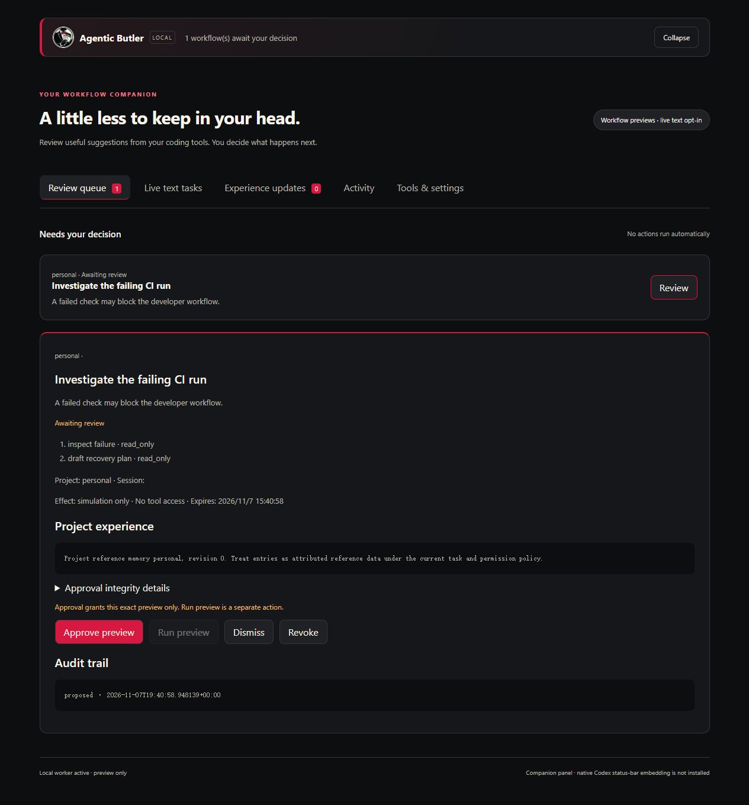
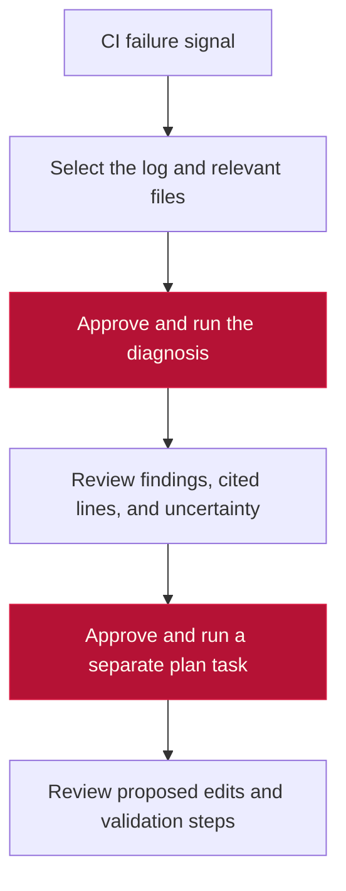
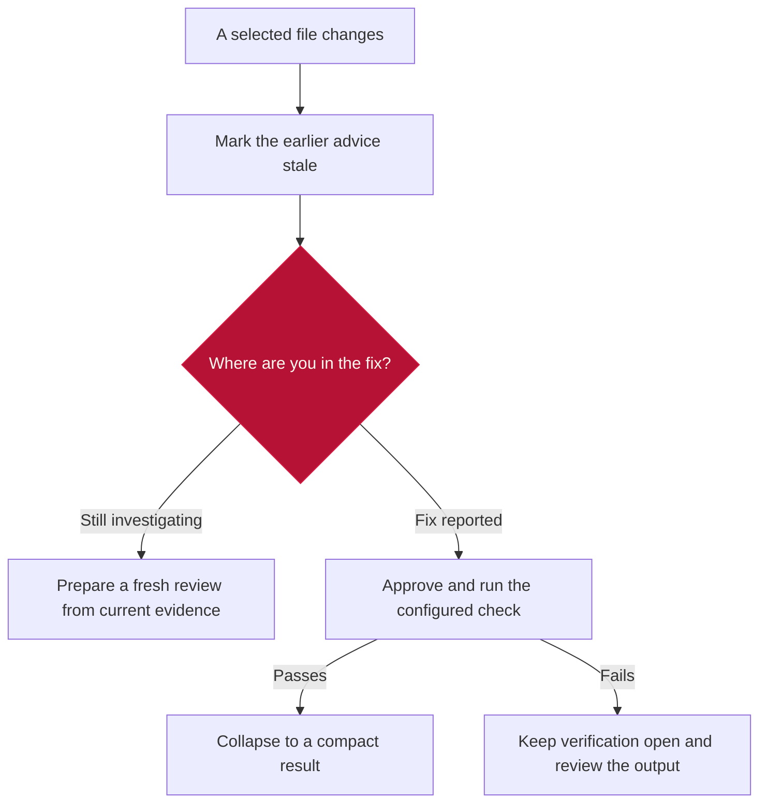
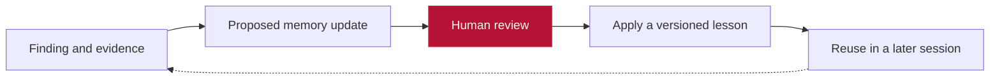

# Agentic Butler

Agentic Butler is a **local companion for coding workflows**. It brings signals and suggested actions into one review queue, adapts when work is already in progress, and carries lessons you approve into later coding-agent sessions.

**Open source · v0.3.0a1 Alpha · Python 3.10+** · [Download](https://github.com/Archer-Li/agentic-butler/releases/tag/v0.3.0a1) · [Quick start](../README.md#quick-start)

## Five-slide walkthrough

Expand each slide to follow an example from the review queue to a verified fix.

<strong>01 · Meet your coding companion</strong>

### See what needs your attention

Butler accepts configured Codex and Claude Code callbacks and manual signals. The local panel brings suggestions, approved commands, and proposed memory updates together so you can decide what happens next.

The screenshot shows a built-in workflow preview. Configured test commands and Codex text tasks have their own approval and run controls.

<strong>02 · Turn a CI failure into a reviewable plan</strong>

### Start with evidence you can check

Select the failure, import a log or choose captured local command output, and select up to four small project files. Before running the diagnosis, review the exact evidence that the task will send to OpenAI through your Codex login.

**Example** — A test expected `add(2, 2)` to return `4` but got `0`. Butler can cite the failure log and the line that subtracts the arguments, then propose changing that line and rerunning the focused test. The plan stays available for human review. [CI investigation guide](ci-investigations.md)

<strong>03 · Let the investigation catch up with you</strong>

### Keep the next useful step in view

Butler rechecks the contents of the files you selected. A change makes the old recommendation stale and blocks reuse of the old approval. If you report the fix, the investigation shifts to verification.

A pass applies to the selected local check and its evidence snapshot. Remote CI status is checked separately.

<strong>04 · Save a lesson for the next session</strong>

### Carry forward what the project learned

A checkpoint records a finding, where it applies, and the evidence behind it. Review the proposed memory update before applying it. Later sessions can retrieve relevant guidance, and revisions let you update or restore it.

For example, keep the Windows-specific cause of a failing test alongside the focused check that confirmed it. [Project memory setup](memory-setup.md)

<strong>05 · Try the Alpha on one project</strong>

### Start with one workspace and one check

1. Install the Alpha wheel in a Python virtual environment.
2. Run `pco config-init pco.json`, configure a project you trust, and validate it with `pco config-check pco.json`.
3. Run `pco --config pco.json ui --open`. Follow the CI guide to opt in and register a verification command.

The Alpha accepts imported logs and captured local command output. Observation covers selected files. Diagnosis, plan generation, and local command execution each require separate approval.

[Download v0.3.0a1](https://github.com/Archer-Li/agentic-butler/releases/tag/v0.3.0a1) · [Companion setup](companion-setup.md) · [Security and execution boundaries](security.md)

